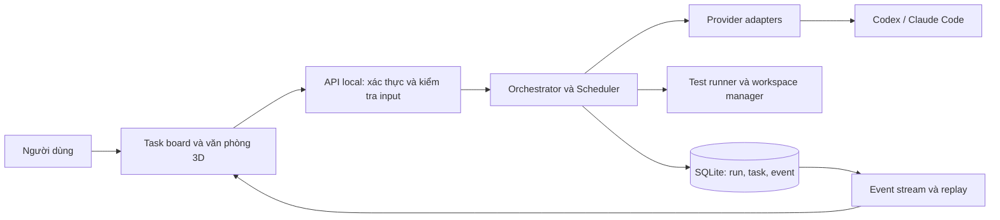

# Kiến trúc hệ thống đề xuất

Trạng thái: draft, phụ thuộc D-01 và D-02. Chưa tạo các thư mục source bên dưới.

## Hình dạng ban đầu

Một backend local có module rõ ràng, một frontend trình duyệt, một database local.
Provider chạy qua adapter; domain scheduler không phụ thuộc trực tiếp vào SDK hay framework web.



## Trách nhiệm module

| Module | Chịu trách nhiệm | Không chịu trách nhiệm |
| --- | --- | --- |
| Web UI | Nhập mục tiêu, task board, scene, log, approvals | Chạy shell, giữ secret, quyết định quyền |
| Application | Tạo run, dispatch, hủy, review gate, budget policy | Render scene |
| Domain | Task graph, transitions, policy, kết quả | SDK/HTTP/SQL cụ thể |
| Provider adapters | Auth status, start/resume/cancel, chuẩn hóa event | Quyết định task nào nên chạy |
| Workspace manager | Workspace allowlist, worktree, artifact paths | Tự merge/deploy |
| Tool runner | Chạy tool được phép, timeout, exit code | Tin lệnh tùy ý từ browser |
| Persistence | Snapshot, event journal, migration | Điều khiển provider |
| Observability | Trace, duration, usage, log đã lọc | Lưu secret/thought nội bộ |

Orchestrator có thể dùng LLM cho phân tích kế hoạch; scheduler thực hiện chuyển trạng thái và policy bằng code.
Không cần gọi LLM để biết một command đã chạy xong hoặc di chuyển avatar.

## Luồng dữ liệu và độ tin cậy

1. Tạo run với workspace, provider, budget và idempotency key.
2. Kiểm tra task graph không có cycle; dispatch task đủ phụ thuộc và còn quota nội bộ.
3. Khóa quyền ghi theo workspace/worktree; cấp execution attempt riêng.
4. Chuẩn hóa provider events; ghi state và journal trong cùng transaction ngắn.
5. Publish sau commit. Client reconnect đọc lại journal theo sequence; giao nhận at-least-once.
6. Client deduplicate bằng eventId; snapshot + sequence làm mốc phục hồi.
7. Test/review gate xác nhận kết quả; UI lấy trạng thái từ backend.

Sau backend restart, run đang chạy chuyển sang interrupted để đối soát.
Không tự chạy lại side effect chưa rõ đã hoàn thành hay chưa. Resume chỉ khi adapter và workspace chứng minh được an toàn.

## Cấu trúc nếu chọn A

```text
apps/
  web/src/
    features/tasks/
    features/office/
    features/approvals/
    features/settings/
  local-server/src/
    domain/
    application/
    adapters/codex/
    adapters/claude/
    infrastructure/persistence/
    infrastructure/workspaces/
    transport/http/
    transport/events/
packages/
  contracts/             # Schema/DTO an toàn để dùng trên frontend
tests/
  integration/
  e2e/
docs/
work/                    # Intermediate files, không commit
data/                    # DB/artifacts local, không commit
```

Chỉ tạo module/package khi có code thực sự; không tạo hàng loạt class rỗng.
Nếu chọn B: giữ apps/web; dùng src/AgentOffice.Api và tests/AgentOffice.Tests;
chỉ tách project Domain/Application/Infrastructure khi quy mô thực tế cần, contracts dùng schema/OpenAPI.

## Lưu trữ

Run, Task, Attempt, AgentAssignment, Event, Artifact, Approval, UsageRecord.
Artifact metadata ở DB; file lớn lưu trong thư mục riêng có giới hạn dung lượng và đường dẫn chuẩn hóa.
Dùng version cho optimistic concurrency; lệnh từ state cũ trả conflict.
Đọc log/events theo cursor, giới hạn số bản ghi và dung lượng. Một service sở hữu kết nối ghi; worker không sửa DB trực tiếp.

## Đồng thời và mức sử dụng

Khởi đầu maxConcurrentWorkers = 1; đề xuất tăng lên 2 sau kiểm thử, cấu hình do người dùng kiểm soát.
Ba vai trò không đồng nghĩa ba process luôn chạy. Provider quota được kiểm tra riêng; không cộng gộp thành một quota.
Pause là ngừng dispatch mới; process đang chạy chỉ dừng nếu provider hỗ trợ và UI mô tả chính xác.
Cancel ngừng dispatch và yêu cầu dừng attempts đang chạy; terminal state chỉ xác nhận sau kết quả dừng.

## UI 3D

Map role/task state sang vị trí, animation và nhãn; không map frame animation sang model request.
Dùng hình đơn giản trước, tải asset nặng sau; tránh cập nhật React state theo từng frame.
Có chế độ giảm chuyển động, chất lượng thấp và task board 2D đầy đủ.
Chỉ hiển thị tiến độ định lượng khi có dữ liệu; không tạo phần trăm hoàn thành giả.
